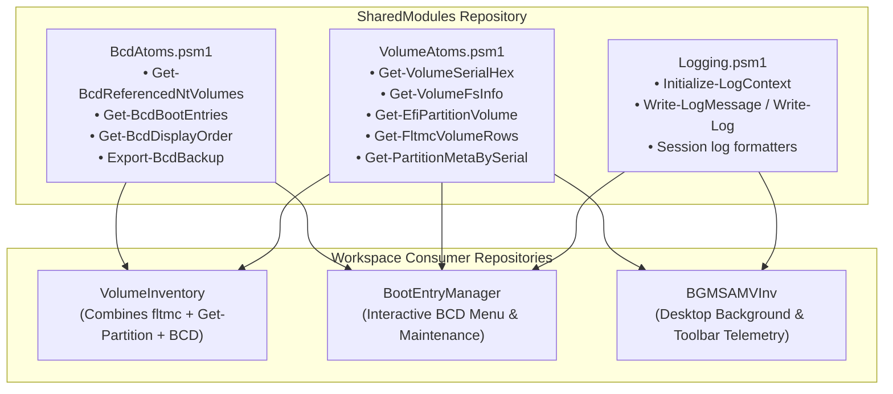

# SharedModules: Architecture Document

Module: docs/Architecture.md  
Authors: Rolf, SharedModules Architecture Team  
Version: 1.3.0  
Status: Authoritative Architecture  
Date: 2026-08-16  

---

## 1. System Architecture & Module Topology

---

## 2. Module Boundary Contracts

### A. `Logging.psm1`
* **Exported Functions**: `Initialize-LogContext`, `Write-LogMessage`, `Write-Log`, `Format-SessionLogFileName`.
* **Behavior**: Safe file append, transcript capture, context state preservation.

### B. `VolumeAtoms.psm1`
* **Exported Functions**: `Get-VolumeSerialHex`, `Get-VolumeFsInfo`, `Get-EfiPartitionVolume`, `Get-FltmcVolumeRows`, `Get-PartitionMetaBySerial`.
* **Behavior**: Low-level storage and volume attribute resolution using `fsutil`, `fltmc`, and `Get-Partition`.

### C. `BcdAtoms.psm1`
* **Exported Functions**: `Get-BcdReferencedNtVolumes`, `Get-BcdBootEntries`, `Get-BcdDisplayOrder`, `Export-BcdBackup`.
* **Behavior**: BCD text parsing, object mapping, and automated safety backups.
