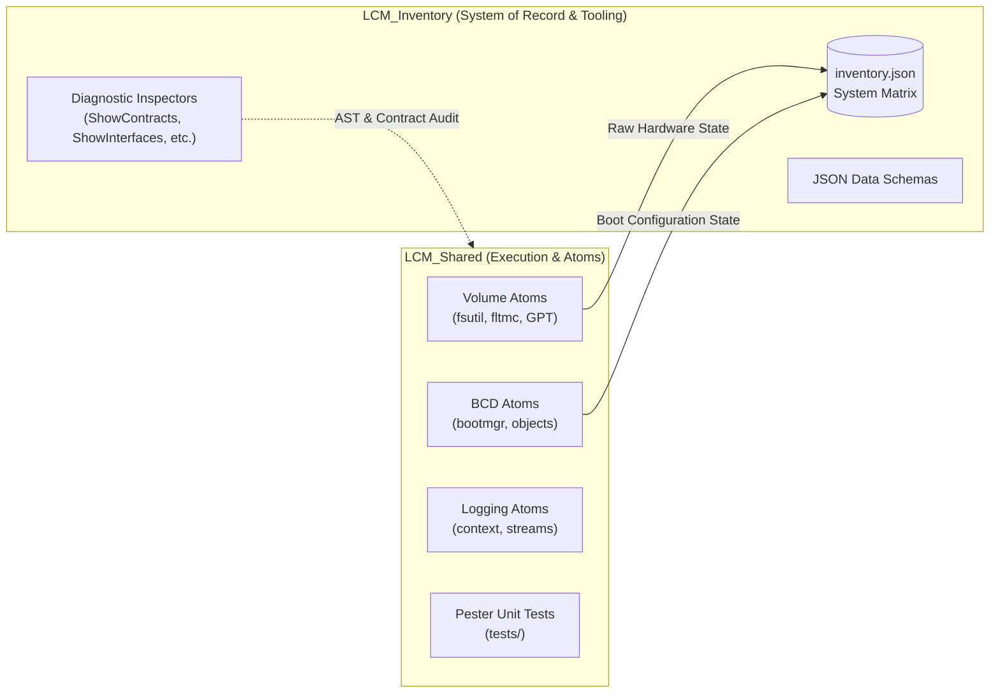

# LCM_Shared: Architectural Specification

Module: docs/Architecture.md  
Purpose: Architectural design, satellite relationship with LCM_Inventory, and component layout for LCM_Shared.  
Path: docs/Architecture.md  
Authors: Rolf, LCM_Shared Architecture Team  
Version: 1.1.0  
Status: Working Draft (NOT Source of Truth - Architectural Concept)  
Date: 2026-09-28  

---

> [!NOTE]
> **Draft Status Warning**: This document is an exploratory architectural working concept and is **currently NOT the authoritative source of truth**. It establishes the draft framework under which `LCM_Shared` acts as a satellite execution repository and atom library aligned with `LCM_Inventory`.

---

## 1. System Context & Architectural Foundation

`LCM_Shared` provides foundational, reusable PowerShell modules ("Atoms") across the Lifecycle Model (LCM) workspace. Under this emerging architecture:

1. **Satellite Execution App for `LCM_Inventory`**:
   - `LCM_Shared` functions as the decoupled, headless execution engine for system introspection and volume topology.
   - It provides pure, stateless atoms that discover, query, and format OS, storage, and BCD data.
   - `LCM_Inventory` acts as the primary data store and system of record that ingests, models, and stores this information.

2. **Decoupled Lifecycle & Physical Separation**:
   - `LCM_Shared` is deliberately maintained in a separate repository to isolate pure module code, Pester tests, and semantic versioning from the frequent commit churn of inventory scans, review receipts, and telemetry data.

---

## 2. Versioning & Ownership Boundaries

| Domain | Governing Repository | Scope & Lifecycle |
| :--- | :--- | :--- |
| **Inspection Tools & Dashboards** | **`LCM_Inventory`** | Governs `ShowContracts`, `ShowInterfaces`, `ShowModules`, `ShowAtoms`, HTML viewers, and validation scanners. |
| **Modules, Sources & Atoms** | **`LCM_Shared`** | Governs `.psm1`/`.psd1` files, core classes, Pester unit tests, and module documentation with independent `M.Y.Z` versioning. |
| **Ecosystem State Registry** | **`LCM_Inventory`** | Single source of truth that tracks, records, and audits all parts of the implementation and their individual versions. |

---

## 3. Core Component Layout

* **`Modules/` & `Source/`**: Pure PowerShell module definitions and atom implementations.
* **`tests/`**: Unit test suites executing mockable Pester tests without host side-effects or system reboots (`REQ-QA-001`).
* **`docs/`**: Tripartite specifications (`Architecture.md`, `Requirements.md`, `Implementation.md`).
